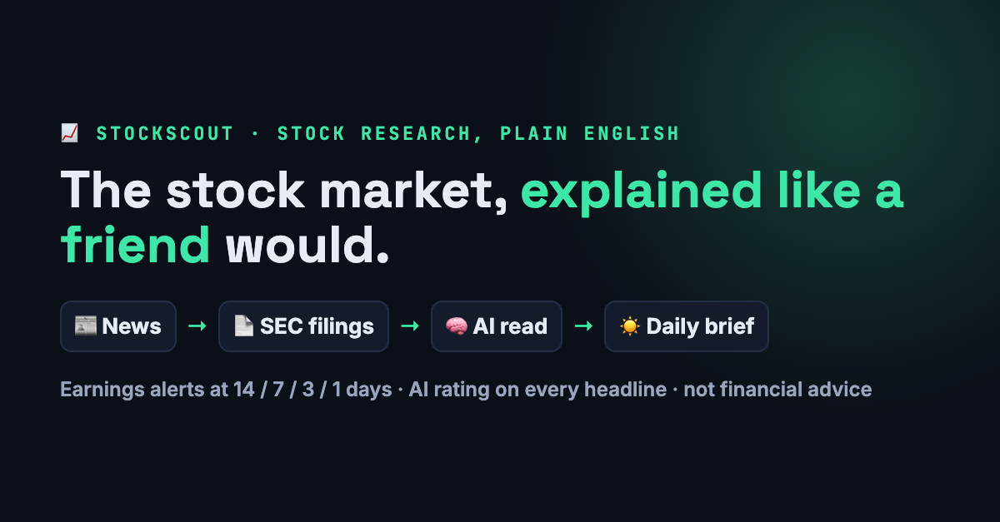

<p align="center"><a href="https://demetriusreynolds251-maker.github.io/stockscout/"></a></p>
<p align="center"><a href="https://demetriusreynolds251-maker.github.io/stockscout/"><b>▶ See how it works</b></a></p>

# 📈 StockScout

**Researches stocks and explains them in plain English.** It writes daily briefs for a watchlist, sends earnings alerts, reads the news and rates each headline, digs through public SEC filings for leadership background and supply chains, and hunts for lesser-known supplier companies. Everything posts to Discord.

> **Note:** Designed and directed by Demetrius Reynolds and built with AI coding assistants. I understand the code and architecture but am not a professional software engineer.

> ⚠️ **Not financial advice.** StockScout is a personal research and learning tool. It doesn't place trades, and nothing it produces is a recommendation to buy or sell anything.

🌐 [About me](https://demetriusreynolds251-maker.github.io) · 🧪 [Apex](https://demetriusreynolds251-maker.github.io/apex/) · 🎯 [Career Hunt](https://github.com/demetriusreynolds251-maker/career-hunt)

---


A small, separate Python project that researches stocks and explains them in plain English.
It is **completely independent**: its own folder, its own job folder, its own Discord channel,
its own packages. It never touches any other project on this machine.

## What it does today

| Command | What you get |
|---|---|
| `python3 run_scout.py report NVDA` | A 10-section plain-English report: what the company does, price, business health, is it expensive, who owns it, what analysts think, next earnings date, leadership, headlines, bottom line. Every finance word is defined where it's used. |
| `python3 run_scout.py daily` | Morning digest for every stock in `config.yaml`: price, growth, P/E, next earnings, two headlines each, plus **earnings alerts** at 14 / 7 / 3 / 1 days out (each alert sent once, never repeated). |
| `python3 run_scout.py calendar` | Upcoming earnings dates on file. |
| `python3 run_scout.py glossary` | Every term and its meaning. |
| `python3 scout_ceo.py NVDA --ceo "Jensen Huang"` | Leadership background from **public records only**: latest proxy statements (bio + pay), 8-K big-news filings, and ready links to SEC enforcement search, Form 4 insider trades, FINRA, court records. Plus a guide on how to read them. No rumors. |
| `python3 scout_news.py NVDA` | **AI news read.** Each headline gets GOOD / BAD / MIXED / NOISE, a 1–5 "how big a deal" score, and a one-sentence plain reason, plus an overall mood line and one thing to watch. Runs automatically inside `daily` and `report` when `anthropic_key.txt` exists; skipped cleanly when it doesn't. Uses the cheap Haiku model (~1–2¢ per daily run). |
| `python3 scout_suppliers.py NVIDIA --ticker NVDA` | **Supplier hunter.** Searches every 10-K filed in the last 2 years for the name, reads the sentences around each mention, labels each company CUSTOMER / SUPPLIER / COMPETITOR / MENTIONS, pulls market cap, and ranks smallest-first with 🟢 for under $50B. Lesser-known partners rise to the top. Add `--no-context` for a fast run that skips downloading filings. Works for any anchor: `scout_suppliers.py "Tesla" --ticker TSLA`. |

Add `--demo` to use saved sample data (no internet). Add `--post` to send to Discord.

## Install on the Mac Mini (one time, ~5 minutes)

```zsh
# 1. Project folder — NOT under ~/Desktop (macOS blocks scheduled jobs there)
mkdir -p ~/stockscout ~/stockscout_jobs
cd ~/stockscout
unzip ~/Downloads/stockscout_v0.1.zip -d ~/stockscout   # or copy the files in

# 2. Packages (its own list; nothing shared)
/usr/bin/python3 -m pip install --user -r requirements.txt

# 3. Discord: make a NEW channel (e.g. #stockscout), add a webhook, paste the URL:
echo "https://discord.com/api/webhooks/..." > discord_webhook.txt
chmod 600 discord_webhook.txt

# 4. SEC asks for a contact email on their free API — edit SEC_UA in scout_ceo.py.
#    Optional AI news read: get a key at console.anthropic.com, then
echo "sk-ant-..." > anthropic_key.txt && chmod 600 anthropic_key.txt

# 5. First live test (no Discord yet)
python3 run_scout.py report NVDA
python3 run_scout.py daily
python3 run_scout.py daily --post      # now it should land in Discord

# 6. Schedule it (7:15 AM daily)
cp jobs/stockscout_daily.sh ~/stockscout_jobs/
sed "s#REPLACE_ME#$USER#g" jobs/com.reynolds.stockscout.plist > ~/Library/LaunchAgents/com.reynolds.stockscout.plist
launchctl unload ~/Library/LaunchAgents/com.reynolds.stockscout.plist 2>/dev/null
launchctl load  ~/Library/LaunchAgents/com.reynolds.stockscout.plist
launchctl list | grep stockscout            # should show the label
launchctl start com.reynolds.stockscout     # fire it once right now to confirm
tail -20 ~/stockscout_jobs/stockscout_daily.log
```

## Adding a stock

Edit `config.yaml`, add a block under `watchlist:` with the ticker, name, and your own one-line
"why". That's it. The daily job picks it up next morning.

## Where things are saved

- `data/` — a dated JSON snapshot of every stock every day (so you can look back), plus `earnings_calendar.json`
- `reports/` — the full Markdown reports
- `~/stockscout_jobs/*.log` — job logs

## What this version does NOT do yet (next steps, in order)

1. ~~Supplier hunting~~ — **done in v0.2** (`scout_suppliers.py`). First live run on the Mini: if it returns zero companies, the SEC search response shape changed — check `search_10k_mentions()` against https://efts.sec.gov/LATEST/search-index?q=%22NVIDIA%22&forms=10-K in a browser.
2. ~~News judgment~~ — **done in v0.3** (`scout_news.py`). If the first live run says the model name isn't recognized, change `ai_model` in `config.yaml` to the current Haiku name from console.anthropic.com.
3. **Pre-earnings deep dive** — 7 days before earnings, auto-generate the full report + the leadership report + last 4 quarters' results vs expectations.
4. **OpenBB** as a second data source (more data, more history) once the basics are stable.
5. **Learning mode** — a weekly "term of the week" post from the glossary.

## Honest limits

- Data comes from Yahoo Finance's free feed. It's good, not perfect; numbers can lag a day.
- The "bottom line" uses simple, visible rules (growth, margins, P/E, short interest). It's a reading aid, not a prediction.
- Leadership research is links + filings, not conclusions. "Shady" is a judgment you make from documents.
- This is research. It does not place trades and does not recommend options or margin.


## Secrets

Keys and webhooks live in plain files that git ignores (`anthropic_key.txt`, `discord_webhook.txt`, `discord_bot_token.txt`). Copy the `.example` files and fill in your own. Saved data, research output and reports are not in this repo.

## License

[Share-Back License 1.1](LICENSE): free to use and learn from for non-commercial purposes. Share what you build or learn back publicly, credit "Based on StockScout by Demetrius Reynolds", and ask before any commercial use.
